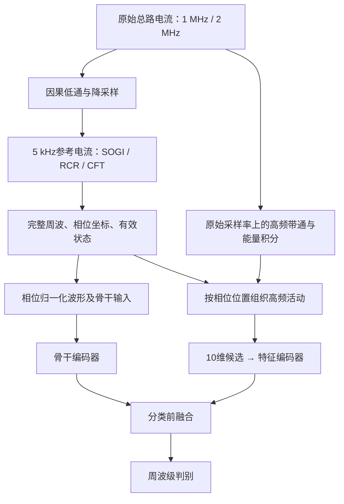

# ARC_YsqPLL

**面向交流串联电弧检测的电流自同步相位表征模块。**

本项目研究如何用电流自身建立周波参考，在统一相位坐标下组织高频活动，并将这些信息接入 ArcFENet、HYDRA 和 ArcFusionNet 三类骨干。

> 当前版本是**候选模块的实现与工程验证版本**：支持原始电流读取、参考估计、因果切窗、特征提取和模型接入。新模块的正式分类训练与贡献消融尚未完成；历史 C0 的成绩不作为本模块的效果证据。

[](https://github.com/2020hao/ARC_YsqPLL/actions/workflows/phase-module.yml)

## 阅读导航

- [项目在解决什么问题](#项目在解决什么问题)
- [整体流程](#整体流程)
- [快速开始](#快速开始)
- [数据与输入格式](#数据与输入格式)
- [从原始录波生成表征](#从原始录波生成表征)
- [10维候选特征](#10维候选特征)
- [接入三个模型](#接入三个模型)
- [目录与职责](#目录与职责)
- [验证与实验规则](#验证与实验规则)
- [Git与进一步开发](#git与进一步开发)

## 项目在解决什么问题

固定20 ms窗口默认电流周期始终相同。频率变化和窗口起点偏移，会让不同周波的对应位置发生错位，影响位置相关特征的比较。

本项目的研究路径是：

**建立电流参考 → 选择完整周波 → 计算相位位置特征 → 与骨干表征融合 → 验证是否改善判别。**

这里估计的是**电流参考相位**。相位归一化用于建立可比较的坐标，并不等于已经消除了所有干扰或恢复了电源电压相位。

### 当前完成情况

| 内容 | 状态 |
|---|---|
| 单通道原始电流读取及采样率检查 | 已实现 |
| 固定20 ms、SOGI、RCR、CFT参考接口 | 已实现 |
| 因果完整周波选择及后备窗口 | 已实现 |
| 原始采样率上的两频带能量积分 | 已实现 |
| 10维相位候选及相位无关／错位对照 | 已实现 |
| 仅在训练分区拟合的标准化 | 已实现 |
| 三个本地骨干的分类前接入 | 已实现并测试 |
| 新模块正式分类训练、消融及独立确认 | 待完成 |

## 整体流程



**5 kHz仅供同步参考使用。** 两个高频带仍在原始1 MHz／2 MHz电流上计算，不从降采样后的参考信号恢复高频。

### 四种参考选项

| `--reference` | 含义 | 用途 |
|---|---|---|
| `fixed20` | 固定20 ms名义坐标 | 固定窗对照 |
| `sogi` | 现有稳健SOGI-PLL内核 | 同步基线 |
| `rcr` | 电流参考恢复，管理观测、有效段和坐标重置 | 当前准备入口默认值 |
| `cft` | 基波一致性恢复与条件趋势跟踪候选 | 单独验证其增益与退化 |

参考不足时保留固定窗后备，并标记其来源；后备窗口不计作成功同步。

## 快速开始

建议使用 Python 3.11 或 3.12：本地验证使用3.12，GitHub自动测试使用3.11。

```bash
git clone https://github.com/2020hao/ARC_YsqPLL.git
cd ARC_YsqPLL
python -m pip install -e '.[dev]'

# 查看候选规格，不运行训练
arc-phase design

# 用随机输入检查三个模型的接口、基线一致性与梯度
arc-phase model-smoke

# 运行可独立复现的模块测试
python -m pytest tests/phase_module -q
```

如只需CPU环境，可先从 [PyTorch CPU安装源](https://download.pytorch.org/whl/cpu) 安装PyTorch，再安装本项目。所有上述检查均可在CPU执行。

源码目录也可直接运行：

```bash
python scripts/phase_module.py design
```

### 当前命令

| 命令 | 作用 |
|---|---|
| `arc-phase design` | 打印候选模块规格 |
| `arc-phase prepare-record` | 从一份原始录波生成无标签波形与相位特征 |
| `arc-phase features` | 从已有频带积分与窗口元数据重新生成特征 |
| `arc-phase model-smoke` | 检查三个骨干的接入接口 |

这些命令不会自动启动正式分类训练。`prepare-record`也不会自动生成ArcFENet的MBWVD图像。

## 数据与输入格式

研究中两个数据集分别训练、分别报告：

| 数据来源 | 原始采样率 | 检测输入 | 标签依据 |
|---|---:|---|---|
| 自采连续5 m总路录波 | 2 MHz | NET9770_114的CH0 | 经审核的正常／电弧时间区间 |
| [Zenodo 5501527](https://doi.org/10.5281/zenodo.5501527) | 1 MHz | C3线路电流 | 作者状态定义、C2辅助核查及项目审核区间 |

公共C2是弧电压，**仅用于离线辅助标注**；检测入口拒绝将C2文件作为电流输入。后续HYDRA作者MAT复现包不作为另一个独立公共数据集。

### 支持的文件

| 格式 | 输入要求 |
|---|---|
| `.bin` | NET9770_114八通道格式；自动读取CH0，核对头部采样率和负载大小 |
| `.dat` | `C3_`开头的两列文本：时间戳、电流；核对时间间隔 |
| `.npy` | 一维、有限值、原生采样率的电流数组；采样率由参数明确声明 |

一个文件包含连续波形，随后可以切出多个窗口。多个窗口仍属于同一次采集，不能随机拆分后声称验证了跨电器泛化。

原始数据、逐记录标签、权重和实验结果保留在本地，不随代码仓库分发。

## 从原始录波生成表征

以下`/path/to/`需要替换为实际数据位置。每次使用新的输出目录，入口会拒绝覆盖已有非空目录。

### 1. 公共电流录波

```bash
arc-phase prepare-record \
  --current /path/to/C3_computer_carbonizedpath.dat \
  --sample-rate 1000000 \
  --reference rcr \
  --output outputs/public_computer_rcr_v1
```

### 2. 自采总路录波

```bash
arc-phase prepare-record \
  --current /path/to/NET9770_114_record.bin \
  --sample-rate 2000000 \
  --reference rcr \
  --output outputs/self_record_rcr_v1
```

### 3. 输出文件

其中`N`表示生成的窗口数量。

| 文件 | 形状／内容 | 用途 |
|---|---|---|
| `wave.npy` | `[N, 1000]` | 50 kHz低频支路的周波归一化波形 |
| `native.npy` | `[N, 5000]` | 250 kHz支路的周波归一化波形，供时频前端进一步处理 |
| `energy.npy` | `[N, 2, 20]` | 原始采样率积分得到的两频带、20相位箱能量 |
| `phase_features.npz` | 10维特征、列名、数值有效性及相位有效性 | 新增特征分支 |
| `windows.csv` | 窗口起止、决策锚点、可用时刻、来源与参考状态 | 对齐、因果性及标签映射核查 |
| `reference_clock.csv` | 同步时钟诊断；固定窗选项为空时钟 | 参考过程检查 |
| `receipt.json` | 原始文件SHA256、采样率、时间原点及准备状态 | 来源追溯 |

这些输出**没有类别标签**。正式训练前还需与审核区间对应、实施边界保护、建立按采集／条件隔离的划分，以及准备各骨干所需输入。

### 4. 从已有能量缓存重新提取特征

```bash
arc-phase features \
  --energy /path/to/energy.npy \
  --metadata /path/to/windows.csv \
  --mode phase \
  --output outputs/phase_features_v1
```

`windows.csv`也可以替换为现有、逐行对应的`cycles.csv`。元数据须包含`phase_valid`或`kind`列，且行顺序与能量数组完全一致。

| `--mode` | 内容 |
|---|---|
| `phase` | 位置相关的10维候选 |
| `phase_free` | 同维度的相位无关统计对照 |
| `shifted` | 每个周波独立循环移位后计算位置特征 |

`phase_free`用于普通信息补充对照，不等于保留了完全相同的信息；`shifted`用于进一步检查位置关系。

## 10维候选特征

频带固定为 **10–100 kHz** 和 **100–400 kHz**，每周波划分为20个相位箱。

| 特征家族 | 维数 | 表达的内容 |
|---|---:|---|
| 两频带对数总能量 | 2 | 高频活动强度 |
| 参考0°／180°邻域能量占比 | 2 | 高频活动是否集中于参考过零邻域 |
| 两半周能量不对称度 | 2 | 对应半周的活动是否不平衡 |
| 二阶圆周矩cos／sin分量 | 4 | 半周尺度的位置朝向与集中结构 |
| **合计** | **10** | 待验证的紧凑候选 |

首轮邻域固定为±18°。该定义及特征集合尚未通过分类消融确认，不代表所有电器的最佳选择。这里描述的是**高频能量相对于参考坐标的位置**，不是高频载波本身的相角。

两个有效性概念分别保存：

- `valid`：某个特征是否具有可用的数值能量依据；
- `phase_valid`：该窗口是否来自有效的原生同步参考。

标准化由`PhaseFeatureScaler`在显式训练索引上拟合；测试数据只调用`transform`。

## 接入三个模型

新模块通过组合保留本地骨干，在分类层前融合相位特征嵌入。骨干内部卷积、随机核或Transformer在本轮结构重构中保持原实现。

| 骨干 | 基线输入准备 | 新分支接入位置 | 实现定位 |
|---|---|---|---|
| ArcFENet | 波形→VMD／MBWVD→图像 | 卷积表征之后、分类之前 | 论文结构重建 |
| HYDRA | 波形→随机核特征 | 核特征与相位嵌入拼接后分类 | 作者核算法的本地适配 |
| ArcFusionNet-current | 波形／导数与训练内选择的FFT频谱 | 时频融合表征之后、分类之前 | 仅电流适配 |

这些本地基线与作者完整方法的差异需要在实验中单独说明，尤其是HYDRA预处理／配置及ArcFusionNet的差分前端。

当前250 kHz波形支路沿用112.5 kHz低通，112 kHz附近存在衰减；这一已知适配限制及参考状态的解释见[模块设计](docs/PHASE_MODULE_DESIGN.md)。

### 最小接口示例

下面使用随机数据检查接入，不进行电弧性能评价：

```python
import numpy as np
import torch

from arc_model.methods.phase_representation import phase_features
from arc_model.training.phase_features import PhaseFeatureScaler
from arc_model.models.factory import make_model
from arc_model.models.phase_adapter import PhaseFeatureAdapter

rng = np.random.default_rng(0)
energy = rng.uniform(0.1, 1.0, size=(6, 2, 20))
batch = phase_features(energy, phase_valid=np.ones(6, dtype=bool))

# 示例中只用前4条拟合标准化，后2条不参与拟合。
scaler = PhaseFeatureScaler.fit(batch, np.array([0, 1, 2, 3]))
features = torch.from_numpy(scaler.transform(batch))

model = PhaseFeatureAdapter(make_model("ArcFENet"), "ArcFENet").eval()
images = torch.randn(6, 3, 100, 100)
with torch.no_grad():
    logits = model(images, features=features)
    baseline_logits = model(images, enabled=False)
print(logits.shape)  # torch.Size([6, 2])
```

融合头从基线分类器初始化，附加特征列置零。关闭模块调用基线路径；开启后的有效增强需要训练。当前实现属于**特征级融合候选**，与历史C0分数级残差是两套方法。

## 目录与职责

```text
ARC_YsqPLL/
├── configs/modules/phase_representation.yaml  # 模块规格说明
├── src/arc_model/
│   ├── data/current_recording.py              # 原始电流读取
│   ├── preprocessing/
│   │   ├── phase_reference.py                # 参考算法统一接口
│   │   └── phase_windows.py                  # 因果窗口与高频积分
│   ├── methods/phase_representation/          # 特征定义与对照
│   ├── training/phase_features.py             # 训练内标准化
│   ├── models/phase_adapter.py                # 三骨干接入
│   └── experiments/phase_cli.py               # 命令组织
├── scripts/
│   ├── phase_module.py                       # 源码运行入口
│   └── export_code_snapshot.py               # 公开代码快照导出
├── tests/phase_module/                        # 可独立运行的模块测试
├── third_party/                              # 保留声明的参考源码
├── docs/                                     # 设计、分层和版本管理说明
└── outputs/                                  # 运行时生成，Git忽略
```

YAML用于说明当前候选规格；现有CLI参数见`--help`，尚未提供从该YAML自动驱动完整训练的入口。历史研究模块继续保留在源码中，公开运行入口以本文列出的四个命令为准。

## 验证与实验规则

模块测试覆盖：

- 活动强度与位置特征的区分；
- 180°极性翻转、相位无关及独立错位对照；
- 标准化仅使用训练数据；
- 原始文件格式检查及拒绝C2检测输入；
- 四种参考路径的前缀因果性与原始高频保留；
- 三个骨干的基线一致性、融合梯度与缺失输入处理。

本地还对两个数据集各一份真实录波完成了输入重放。它验证接口和数值一致性，不替代分类性能验证。

后续正式实验应遵循：

1. 两个数据集分别训练和报告，使用审核标签；
2. 按原始采集／条件分组，整份文件的周波不跨同一轮训练与测试；
3. 同步、固定窗、普通融合、错位对照使用可比的信息与预算；
4. 以条件等权周波BAcc为主，结合Recall、FPR、F1、AP和组级配对区间；
5. 保留不利结果，并计入参考、预处理、模型和附加分支的完整成本。

本研究服务器的训练GPU策略为**仅使用物理GPU1、2、3，保留GPU0**。本README中的测试命令可在CPU完成。

## Git与进一步开发

GitHub仅同步可复用代码、规格、测试和选定文档。历史论文生成器、数据、标签明细、权重及结果留在本地。

本地`research-baseline-20261029`标签及`research/local-main`分支保存重构前研究状态；日常公开开发以`main`为基线，避免将私有历史分支整体推送。

| 文档 | 内容 |
|---|---|
| [模块设计](docs/PHASE_MODULE_DESIGN.md) | 输入输出、特征定义、接入与消融 |
| [代码分层](docs/CODEBASE_GUIDE.md) | 各层职责和依赖方向 |
| [Git工作流](docs/GIT_WORKFLOW.md) | 版本记录、公开快照及本地证据管理 |
| [第三方来源](docs/THIRD_PARTY_NOTICES.md) | 参考实现、论文与来源说明 |

仓库保留第三方原有声明；数据的引用与许可遵循对应原始发布记录。
